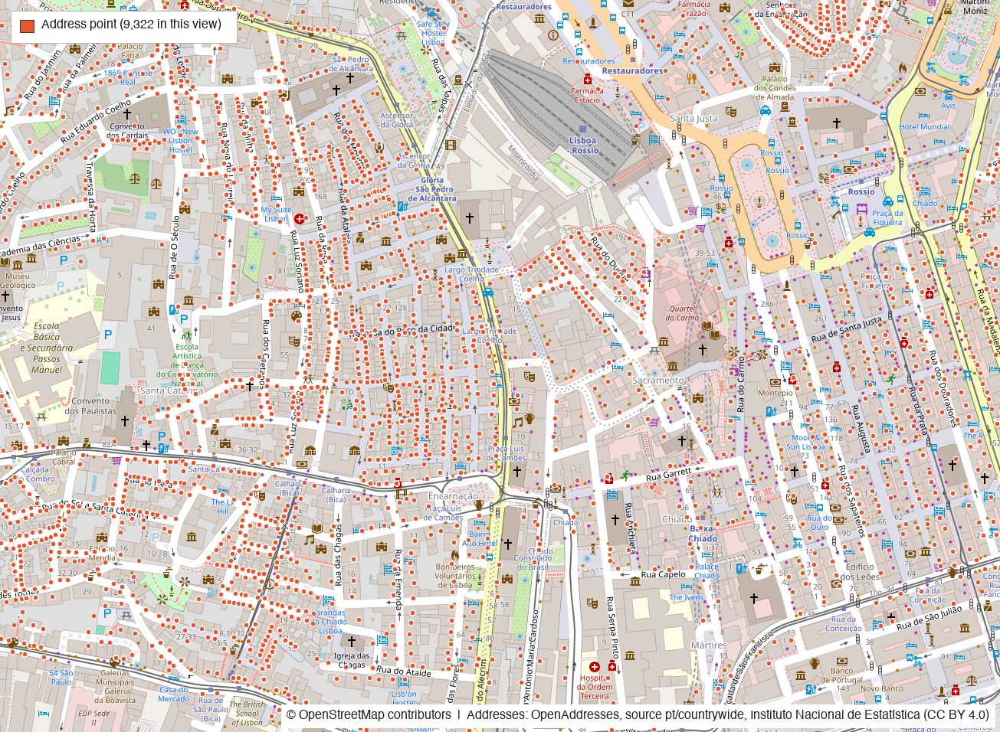

# OpenAddresses Downloader (QGIS plugin)

> **Unofficial.** This plugin is not made, endorsed or supported by OpenAddresses. It reads the files OpenAddresses publishes. Report problems with the plugin [here](https://github.com/ColdLabs/qgis-openaddresses/issues), not to OpenAddresses.

Downloads [OpenAddresses](https://openaddresses.io/) address points for the map view or the polygons of a layer. Attributes: `number`, `street`, `unit`, `city`, `district`, `region`, `postcode`, `id`, `accuracy`, `hash`. Output CRS is EPSG:4326.

A second output, **Source licences**, lists the sources that may cover the area and their licences. It is a table without geometry: `source`, `source_layer`, `licence`, `licence_url`, `attribution`, `website`, `coverage_note`, `share_alike`.

Coverage is about 2,300 sources in 70+ countries, densest in the United States. Where two sources cover the same place (a city and its county), the same address can appear once for each.



*Central Lisbon, Portugal: 9,322 address points from the plugin. The Source licences output named one source here, pt/countrywide (Instituto Nacional de Estatística, CC BY 4.0).*

## Install

In QGIS: **Plugins → Manage and Install Plugins → All**, search for "OpenAddresses Downloader", then **Install**. Requires QGIS 3.38 or later (Qt5 or Qt6) with GDAL 3.8 or later, which current QGIS installers include. No extra Python packages are needed.

To install without the plugin repository, download the zip from the [latest release](https://github.com/ColdLabs/qgis-openaddresses/releases/latest) and use **Plugins → Manage and Install Plugins → Install from ZIP**.

## Use

- Toolbar button (Web toolbar) or **Web → OpenAddresses**: opens the dialog with the current map extent filled in. If the active layer is a polygon layer with selected features, those become the area.
- **Processing Toolbox → OpenAddresses → Download addresses**: same algorithm; works in models and batch mode.
- Command line:

```
qgis_process run openaddresses:download -- EXTENT="-9.16,-9.12,38.70,38.74 [EPSG:4326]" OUTPUT=addresses.gpkg LICENCES=licences.gpkg
```

The dialog writes two outputs: the addresses and the Source licences table. `qgis_process` writes the licences table only when `LICENCES` is set. Read the licences before you reuse the addresses.

The run stops before reading anything if the area covers more zoom-14 map tiles than "Stop if the area needs more map tiles than" (2000 by default). A tile is about 2.4 km across at the equator and smaller towards the poles.

## How it fetches data

OpenAddresses publishes every address in one global PMTiles file, `https://v2.openaddresses.io/fabric/addresses.pmtiles`. Its zoom-14 tiles hold every address. The plugin:

1. Reads only the zoom-14 tiles over the area through GDAL.
2. Keeps the addresses inside the area, and drops the copies that tippecanoe repeats along tile edges.
3. Lists the sources whose bounding box touches the area, from `sources.json`, then keeps those whose state or country also touches it, from `outlines.json`. Both files ship with the plugin and are used only for the licence list. The outlines are [Natural Earth](https://www.naturalearthdata.com/) 1:50m countries and states (public domain), grown by about 5 km so coasts and small islands count as inside. A source whose state and country have no outline is kept.

No OpenAddresses API calls are made during a run. GDAL reads the tiles over HTTP itself; QGIS passes its proxy settings on to GDAL.

Rebuild the index before a release:

```
python3 tools/build_index.py
```

`python3 tools/build_index.py --keep-boxes` refreshes only the licences and websites from the openaddresses/openaddresses repository and makes no API calls. `tools/build_outlines.py` rebuilds `outlines.json` and needs GDAL's Python bindings, for example `/Applications/QGIS.app/Contents/MacOS/python tools/build_outlines.py`.

## Data licence

Every OpenAddresses source has its own licence, and many do not state one. The global file does not say which source each address came from. So the plugin cannot put a licence on each address.

Instead, the Source licences output lists every source whose bounding box touches the area, inside its own state or country. Each row has the licence, licence URL, the name to credit, whether the licence is share-alike and the publisher's website, as recorded in the [openaddresses/openaddresses](https://github.com/openaddresses/openaddresses) source files.

- Where sources overlap, you cannot tell which licence applies to which address. Treat every listed licence as possibly applying.
- Some sources have bounding boxes far larger than their data, so a source can be listed for an area where it has no addresses. When a box is much larger than that kind of source can be (over 20° for a city or county, over 30° for a state), `coverage_note` says so. The row stays, because the source may still apply.
- An empty licence means the source does not state one. Check the terms on the publisher's website (`website`) before reusing the data.
- Sources added to OpenAddresses after the index was built are not listed. The run log gives the index date.

This is an unofficial plugin, not made or endorsed by OpenAddresses.

## Development

Link the plugin folder into your QGIS profile instead of installing the zip (macOS, QGIS 4):

```
ln -s "$PWD/openaddresses_downloader" ~/Library/Application\ Support/QGIS/QGIS4/profiles/default/python/plugins/
```

`./build_zip.sh` writes `dist/openaddresses_downloader-<version>.zip` for upload to plugins.qgis.org.
`./check.sh` runs the scanners the plugin site runs: Bandit and detect-secrets block an upload, flake8 is advisory.

## Licence

GPL-2.0-or-later. See [LICENSE](LICENSE).
